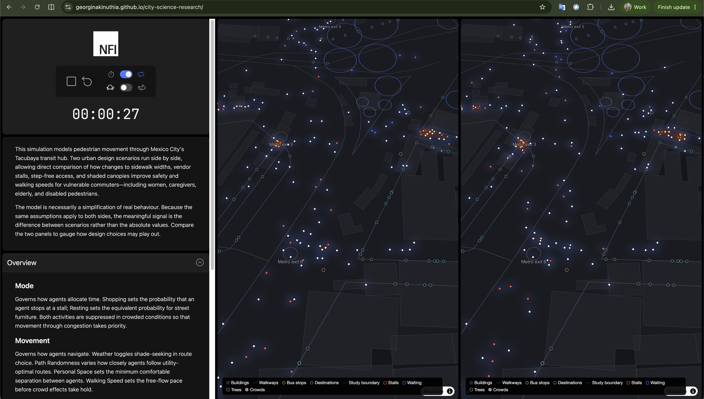

# Buen Camino: Tacubaya Pedestrian ABM (CDMX)

[](https://georginakinuthia.github.io/city-science-research/)

[](https://georginakinuthia.github.io/city-science-research/)

Agent-based pedestrian microsimulation for the Tacubaya transit hub in Mexico City (CDMX). The model combines multinomial logit (MNL) route choice (Antonini et al. 2006) with ORCA collision avoidance (van den Berg et al. 2011) and Weidmann speed-density relationships to simulate how urban design interventions—sidewalk widening, vendor formalization, shaded canopies, and step-free thresholds—shape pedestrian flow, spatial comfort, and accessibility for vulnerable personas (female commuters, caregivers, elderly, and mobility-impaired pedestrians).

- **Live Simulation**: https://georginakinuthia.github.io/city-science-research/
- **Repository**: https://github.com/georginakinuthia/city-science-research

## Getting Started

```bash
npm install
npm run dev        # start dev server
```

Other commands:

```bash
npm run build      # type-check + production build
npm run preview    # preview production build
npm run test       # run tests (Vitest)
npm run typecheck  # vue-tsc type checking
npm run lint       # ESLint + auto-fix
npm run format     # Prettier check
```

## Tech Stack

- **Simulation** — Custom in-house SoA sim layer ([src/sim/](src/sim/)): flat `Float32Array` cell fields, parallel agent arrays, pre-baked cell color buffer, batched-path canvas renderer
- **Frontend** — Vue 3, Pinia, Vite, Tailwind CSS
- **Map** — MapLibre GL
- **Geospatial** — Turf.js, @thi.ng/distance-transform
- **Charts** — Chart.js, D3

### History

Early versions of this project used [AgentScript](https://github.com/backspaces/agentscript) as the ABM framework. AgentScript was removed in favour of a purpose-built sim layer because:

- **Not formally released.** The only publication channel was a pinned GitHub tarball (`github:backspaces/agentscript#<sha>`), not a semver npm package. That caused repeat build-tooling breakage and made reproducible installs fragile.
- **Not actively maintained.** The upstream repo hasn't had substantive updates in a long time, so bugs we hit had no path to a fix.
- **Bundled outdated three.js.** AgentScript carried a pinned version of three.js with known security advisories, which forced a transitive-dependency override on every install.
- **Shape mismatch.** Most of AgentScript's surface (breeds, links, NetLogo-flavoured lazy getters, flyweight `Patch` objects, sprite rotation, geometry modes) was dead weight for a pedestrian microsim — the only parts we actually used were a thin grid, an agent collection, a `setInterval` tick loop, and a canvas painter for maplibre-gl.

The replacement in [src/sim/](src/sim/) is a complete rewrite designed around **what this simulation actually needs**: cache-friendly SoA cell storage on `Float32Array`s, parallel agent arrays (also SoA), a pre-baked cell color buffer so per-frame cell draw is a single `Uint32Array.set()` memcpy, and a batched-path renderer so agents draw as ~12 fills per frame instead of hundreds of `drawImage` calls. Coordinate convention is `y=0 = north, y grows south` (matches maplibre's canvas-source orientation directly — no flips). Dropping AgentScript shrunk the app bundle by ~40 KB and removed the vulnerable bundled three.js entirely (the project now pins its own current three.js). The sim preserves the pre-existing scenario pipeline byte-for-byte; the baseline fixture test at [src/stores/**tests**/baseline.fixture.test.ts](src/stores/__tests__/baseline.fixture.test.ts) asserts that all Dijkstra distance-field summary statistics match the pre-refactor snapshot exactly.

## Project Structure

```text
src/
├── config.ts                  # all tunable constants (grouped by domain)
├── sim/
│   ├── Simulation.ts          # SoA sim monolith — grid + agent typed arrays, step pipeline
│   ├── colors.ts              # u32-packed RGBA helpers (no per-pixel allocation)
│   ├── tick.ts                # createLoop — fixed-interval free function (replaces Animator)
│   └── createMapRenderer.ts   # canvas renderer — pre-baked cell buffer + batched agent paths
├── models/
│   └── orca.ts                # ORCA collision avoidance solver (allocation-free)
├── stores/
│   ├── behavior.ts            # movement pipeline & MNL route choice (SoA, free functions)
│   ├── simulation.ts          # simulation loop & timing
│   ├── scenarios.ts           # scenario data loading (GeoJSON)
│   ├── geo.ts                 # distance fields, potentials, decay factors
│   ├── sandbox.ts             # sandbox test environment
│   └── sandboxTerrains.ts     # test terrain definitions
└── components/
    ├── MapView.vue            # main corridor visualisation
    ├── SandboxView.vue        # simplified test view
    ├── CentralControl.vue     # statistics display
    ├── ModeControl.vue        # weather / scenario controls
    ├── MovementControl.vue    # behaviour parameter sliders
    └── SpawnControl.vue       # persons-per-hour controls

public/
├── scenarioA/                 # GeoJSON: surfaces, structures, shade, stalls, furniture
├── scenarioB/
├── ft_before/ & ft_after/     # comparison scenarios
└── nodes.geojson              # spawn / destination nodes
```

## Movement Pipeline

Each tick, every agent runs through these stages in order:

1. **MNL route choice** — softmax over 8 neighbour patches with utility coefficients for distance, alignment, opposition-weighted density, obstacles, and shade (gated off at high density)
2. **Amenity engagement** — probabilistic triggering for shopping (stalls) or waiting (furniture), with progressive slowdown
3. **Surface recovery** — corrective steering back onto walkable surfaces
4. **Following** — position-based steering toward the nearest co-directional agent ahead, density-gated by oncoming traffic count
5. **Heading momentum** — temporal smoothing of heading changes (capped at 80%), applied before ORCA, so collision avoidance is never dampened
6. **Weidmann speed reduction** — density-dependent speed following Weidmann (1993), plus pinch-point slowdown from oncoming traffic
7. **ORCA collision avoidance** — velocity-space half-plane LP with direct heading authority; runs last, so collision avoidance is never overridden
8. **Barrier snap-back** — hard physical guarantee against wall/stall penetration (post-movement check)

## Simulation Parameters

| Parameter          | Value                                                                    |
| ------------------ | ------------------------------------------------------------------------ |
| Duration           | 1 hour (3600 s)                                                          |
| Frame rate         | 30 FPS                                                                   |
| Normal tick        | 0.25 s (total: 14,400 ticks)                                             |
| Fast tick          | 1.0 s (total: 3,600 ticks)                                               |
| Base walking speed | 1.34 m/s — Weidmann (1993) meta-analysis mean (configurable 0.8–2.0 m/s) |
| Arrival radius     | 2 m                                                                      |

Speed can be toggled between normal and fast during the simulation without affecting the countdown timer.

## Agent Behaviour

### Route Choice

Agents evaluate 8 neighbouring patches using a Multinomial Logit model (Antonini et al. 2006). Utility includes distance-to-target, forward alignment, opposition-weighted density (oncoming agents weighted 5× co-directional), obstacle proximity, and shade potential (gated off when local density exceeds 0.8 ped/m², so crowd avoidance dominates). Per-agent route-straightness, directional bias, and stable Gumbel-like hash noise introduce individuality, scaled by the Path Randomness parameter.

### Amenity Engagement

- **Furniture** (waiting) and **stalls** (shopping) each have a per-minute engagement probability
- Only triggers on walkable surfaces (potential > 0.1)
- Agents progressively slow to as low as 5% of cruising speed while engaged
- Duration sampled per agent, scaled by configurable max minutes

### Following & Queuing

When agents detect oncoming pedestrians ahead, they steer toward the nearest co-directional agent's position, forming single-file chains. This is density-gated: agents walk freely in open space and only queue when facing oncoming traffic (ramps from 0 to 3 oncoming agents). Speed also reduces at pinch points with heavy opposing flow (up to 50% slowdown).

### Collision Avoidance

ORCA-based velocity-space solver (van den Berg et al. 2011) that computes smooth lateral sidestepping:

- Neighbour search: up to 6 agents within 10 m
- Half-plane constraint LP with speed-disc clamp
- Head-on resolution: right-leg projection breaks symmetry (pass on right)
- Direct heading authority: ORCA output is used directly, not blended — runs last in the pipeline
- Deflection damping: large turns (90°+) reduce speed proportionally (20% floor) instead of sharp swerves
- Wall guard: if ORCA would push agent off walkable surface, falls back to pre-ORCA heading at 50% speed
- Engaged agents comply only 30% with ORCA, preserving amenity-seeking behaviour

### Speed & Surfaces

- Weidmann fundamental diagram: speed reduces automatically as local density increases (standstill at 5.4 ped/m²)
- Pinch-point slowdown: oncoming traffic further reduces speed (up to 50%)
- Surface recovery: agents on non-walkable patches (potential < 0) get a hard heading override back onto walkable area
- Shade is integrated into MNL route choice (not a separate steering force) — active only when sunny and uncrowded

## Metrics

The model tracks per-scenario:

- **Arrivals** — agents reaching their destination
- **Ease of movement** — proxemic zone distribution (Hall 1966), scaled by the Personal Space parameter: public (&gt;4.1×), social (1.35–4.1×), personal (1.0–1.35×), intimate (&lt;1.0×)
- **Shopping / resting minutes** — cumulative engagement time

## UI Controls

- **Play / Stop / Reset** — simulation lifecycle
- **Speed toggle** — normal vs 4x fast mode
- **Weather** — sunny / cloudy (toggles shade-seeking in MNL route choice)
- **Path Randomness** — per-agent variation in route preference and walking style
- **Personal Space** — minimum comfortable distance; maps to ORCA collision radius
- **Walking Speed** — free-flow speed before crowd effects (default 1.34 m/s)
- **Shopping / Resting Likelihood** — per-minute engagement probabilities for stalls and furniture
- **Spawn rates** — persons per hour, per entry node

## Literature

See [LITERATURE.md](LITERATURE.md) for the full literature review covering:

- Antonini, Bierlaire & Weber (2006) — discrete choice pedestrian models (MNL route choice)
- van den Berg et al. (2011) — ORCA collision avoidance
- Weidmann (1993) — speed-density fundamental diagram
- Hall (1966) — proxemic distance zones
- Moussaïd, Helbing & Theraulaz (2011) — simple rules for pedestrian behaviour (following)
- Reynolds (1987) — flocking / alignment / cohesion (following)
- Helbing & Molnár (1995) — social force model (momentum smoothing analogy)
